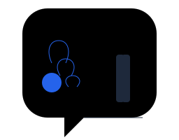

# CastAll

<p align="center">
  
</p>

<p align="center">
  <strong>Instant Browser-Based Wireless Presentation System</strong>
</p>

<p align="center">
  Share your screen to any device instantly - no software installation required.
</p>

<p align="center">
  <a href="#"></a>
  <a href="#"></a>
  <a href="#"></a>
  <a href="#"></a>
  <a href="#"></a>
</p>

---

## Table of Contents

- [Overview](#overview)
- [Key Features](#key-features)
- [Screenshots](#screenshots)
- [Demo](#demo)
- [Technology Stack](#technology-stack)
- [Project Structure](#project-structure)
- [Installation](#installation)
- [Environment Variables](#environment-variables)
- [Usage Guide](#usage-guide)
- [Application Workflow](#application-workflow)
- [Architecture Overview](#architecture-overview)
- [Responsive Design](#responsive-design)
- [Performance](#performance)
- [Security](#security)
- [Accessibility](#accessibility)
- [Browser Support](#browser-support)
- [Platform Limitations](#platform-limitations)
- [Scripts](#scripts)
- [Deployment](#deployment)
- [Testing](#testing)
- [Troubleshooting](#troubleshooting)
- [Roadmap](#roadmap)
- [Contributing](#contributing)
- [License](#license)
- [Author](#author)
- [Acknowledgements](#acknowledgements)

---

## Overview

CastAll is a browser-based wireless presentation system. It enables instant screen sharing between a presenter and a host using modern web technologies. No software installation, no account creation, no complex setup - users share or join a presentation in seconds.

### Problem Solved

Traditional screen sharing solutions require:
- Software installation on all devices
- Account creation and login
- Complex network configuration
- Long room codes or meeting IDs

CastAll replaces all of this with a simple, browser-based solution using QR code room joining and peer-to-peer screen sharing.

### Target Users

- **Presenters** - lecturers, teachers, meeting hosts, and anyone who needs to share their screen
- **Hosts** - viewers who receive a presentation on a laptop, TV, or large panel
- **Organizations** - teams looking for a simple, zero-install screen sharing solution

### Current Deployment

- **Frontend**: https://castall.onrender.com
- **Backend**: https://castall-backend.onrender.com

---

## Key Features

### Core Features
- **No Installation Required** - works entirely in the browser
- **QR Code Room Joining** - scan a QR code to join a presentation instantly
- **Room Code Sharing** - enter a 6-character room code manually
- **Real-Time Screen Sharing** - low-latency peer-to-peer streaming via WebRTC
- **Request Approval System** - hosts approve or reject presentation requests
- **Theme Switching** - light and dark theme support with persistence
- **Responsive Design** - optimized for desktop, tablet, and mobile devices
- **Connection Status Indicators** - visual feedback for connection state
- **Animated Backgrounds** - physics-based decorative animations
- **Room Expiration** - automatic cleanup of inactive rooms

### QR Features
- **QR Code Generation** - automatic QR code generation for each room
- **Camera Scanning** - live QR code scanning via device camera
- **Image Upload Scanning** - scan QR codes from uploaded images

### User Experience
- **One-Click Theme Toggle** - switch between light and dark modes
- **Copy Room Code** - one-click copy to clipboard
- **Exit Button** - clean session termination
- **Toast Notifications** - real-time feedback for user actions
- **Before-Unload Warning** - prevent accidental page closes during active sessions

---

## Screenshots

| Page | Screenshot |
|------|-----------|
| Landing Page |  |
| Host Page |  |
| Share Page |  |
| Presentation Page |  |
| Light Mode |  |
| Dark Mode |  |
| QR Scanner |  |
| Screen Sharing |  |

> Screenshots are placeholders. Replace with actual application screenshots.

---

## Demo

**Live Demo**: https://castall.onrender.com

---

## Technology Stack

### Frontend
| Technology | Purpose |
|------------|---------|
| React 18 | UI Library |
| TypeScript | Type Safety |
| Vite | Build Tool & Dev Server |
| Tailwind CSS | Utility-First CSS Framework |
| Socket.IO Client | Real-Time Communication |
| html5-qrcode | QR Code Scanning |
| qrcode | QR Code Generation |
| lucide-react | Icon Library |
| sonner | Toast Notifications |
| zod | Schema Validation |
| react-router-dom | Client-Side Routing |
| tailwind-merge | Class Name Merging |
| clsx | Conditional Class Names |

### Backend
| Technology | Purpose |
|------------|---------|
| Node.js | Runtime Environment |
| Express | Web Framework |
| Socket.IO | Real-Time Signaling Server |
| Pino | Structured Logging |
| Helmet | Security Headers |
| CORS | Cross-Origin Resource Sharing |
| nanoid | Unique ID Generation |
| zod | Input Validation |

### Communication
| Technology | Purpose |
|------------|---------|
| WebRTC | Peer-to-Peer Screen Sharing |
| Socket.IO | Signaling & Room Management |

### Development & Build
| Technology | Purpose |
|------------|---------|
| TypeScript | Language |
| ESLint | Code Linting |
| Vite | Frontend Build Tool |
| tsx | Backend Dev Server |
| npm | Package Manager |

---

## Project Structure

```
castall/
├── backend/
│   ├── src/
│   │   ├── config/
│   │   │   └── env.ts              # Environment configuration with zod validation
│   │   ├── constants/
│   │   │   └── index.ts            # Application constants
│   │   ├── logger/
│   │   │   └── pino.ts             # Pino logger configuration
│   │   ├── managers/
│   │   │   └── roomManager.ts      # In-memory room state management
│   │   ├── routes/
│   │   │   └── health.ts           # Health check endpoint
│   │   ├── services/
│   │   │   └── roomService.ts      # Room business logic
│   │   ├── sockets/
│   │   │   ├── index.ts            # Socket.IO server setup
│   │   │   └── room.ts             # Room-related socket handlers
│   │   ├── types/
│   │   │   ├── room.ts             # Room type definitions
│   │   │   └── socket.ts           # Socket type definitions
│   │   ├── utils/
│   │   │   ├── codeGenerator.ts    # Room code and session token generation
│   │   │   ├── rateLimiter.ts      # Room creation rate limiting
│   │   │   └── validation.ts       # Input validation schemas
│   │   ├── app.ts                  # Express app configuration
│   │   └── server.ts               # HTTP server entry point
│   ├── .env                        # Environment variables (not committed)
│   ├── .env.example                # Environment template
│   ├── package.json                # Backend dependencies and scripts
│   └── tsconfig.json               # TypeScript configuration
├── frontend/
│   ├── public/
│   │   └── castall-logo.svg        # Application logo
│   ├── src/
│   │   ├── components/
│   │   │   ├── presentation/
│   │   │   │   ├── BackgroundEffects.tsx    # Physics-based background animation
│   │   │   │   ├── PresentationScreen.tsx   # Full-screen video display
│   │   │   │   ├── ScreenRecommendation.tsx # Screen sharing recommendation
│   │   │   │   └── StartSharing.tsx         # Start sharing button/flow
│   │   │   ├── qr/
│   │   │   │   ├── QRCodeCard.tsx           # QR code display component
│   │   │   │   └── QRCodeScanner.tsx        # QR scanner modal (camera + image)
│   │   │   ├── room/
│   │   │   │   ├── HostCard.tsx             # Host room management UI
│   │   │   │   ├── JoinCard.tsx             # Join room form UI
│   │   │   │   └── WaitingForApproval.tsx   # Waiting for approval UI
│   │   │   └── ui/
│   │   │       ├── ConnectionStatusButton.tsx # Connection status indicator
│   │   │       └── Spinner.tsx             # Spinner component
│   │   ├── contexts/
│   │   │   ├── RoomContext.tsx       # Room state management
│   │   │   └── ThemeContext.tsx      # Theme state management
│   │   ├── hooks/
│   │   │   ├── useClipboard.ts       # Clipboard copy functionality
│   │   │   ├── useScreenShare.ts     # Screen sharing hook
│   │   │   ├── useSocket.ts          # Socket.IO connection hook
│   │   │   └── useWebRTC.ts          # WebRTC peer connection hook
│   │   ├── layouts/
│   │   │   └── AppLayout.tsx         # Main layout with navbar and theme provider
│   │   ├── pages/
│   │   │   ├── ErrorPage.tsx         # Error page
│   │   │   ├── HostPage.tsx          # Host/room creation page
│   │   │   ├── LandingPage.tsx       # Landing/home page
│   │   │   ├── PresentationPage.tsx  # Active presentation view
│   │   │   └── SharePage.tsx         # Join room page
│   │   ├── services/
│   │   │   ├── room.ts               # Room API service
│   │   │   ├── socket.ts             # Socket.IO service
│   │   │   └── webrtc.ts             # WebRTC service
│   │   ├── types/
│   │   │   ├── room.ts               # Room type definitions
│   │   │   ├── socket.ts             # Socket type definitions
│   │   │   └── webrtc.ts             # WebRTC type definitions
│   │   ├── utils/
│   │   │   ├── constants.ts          # Application constants
│   │   │   ├── formatters.ts         # Time and room code formatters
│   │   │   └── validators.ts         # Zod validation schemas
│   │   ├── App.tsx                   # Root component with routing
│   │   ├── main.tsx                  # Application entry point
│   │   ├── index.css                 # Global styles and animations
│   │   └── vite-env.d.ts             # Vite type declarations
│   ├── index.html                    # HTML entry point
│   ├── package.json                  # Frontend dependencies and scripts
│   ├── tailwind.config.ts            # Tailwind CSS configuration
│   ├── tsconfig.json                 # TypeScript configuration
│   └── vite.config.ts                # Vite configuration
├── .gitignore                         # Git ignore rules
├── package.json                       # Root workspace configuration
├── package-lock.json                  # Locked dependency versions
└── README.md                          # Project documentation
```

---

## Installation

### Prerequisites

- **Node.js** 18+ and npm
- **Git**

### Setup Steps

1. **Clone the repository**
   ```bash
   git clone <repository-url>
   cd castall
   ```

2. **Install dependencies**
   ```bash
   npm run install:all
   ```

3. **Configure environment variables**
   ```bash
   cp backend/.env.example backend/.env
   cp frontend/.env.example frontend/.env
   ```
   Edit `.env` files with your configuration. See [Environment Variables](#environment-variables) for details.

4. **Run development servers**
   ```bash
   npm run dev
   ```
   This starts:
   - Backend server on `http://localhost:3000`
   - Frontend dev server on `http://localhost:5173`

5. **Open the application**
   Navigate to `http://localhost:5173` in your browser.

---

## Environment Variables

### Backend (backend/.env)

| Variable | Description | Default |
|----------|-------------|---------|
| `NODE_ENV` | Application environment | `development` |
| `PORT` | Backend server port | `3000` |
| `FRONTEND_URL` | Frontend application URL | `http://localhost:5173` |
| `STUN_SERVER` | STUN server URL for WebRTC | `stun:stun.l.google.com:19302` |
| `TURN_SERVER` | TURN server URL (optional) | - |
| `TURN_USERNAME` | TURN server username (optional) | - |
| `TURN_PASSWORD` | TURN server password (optional) | - |

### Frontend (frontend/.env)

| Variable | Description | Default |
|----------|-------------|---------|
| `VITE_SOCKET_URL` | Backend Socket.IO server URL | `http://localhost:3000` |
| `VITE_STUN_SERVER` | Frontend STUN server URL | `stun:stun.l.google.com:19302` |
| `VITE_TURN_SERVER` | Frontend TURN server URL (optional) | - |
| `VITE_TURN_USERNAME` | Frontend TURN username (optional) | - |
| `VITE_TURN_PASSWORD` | Frontend TURN password (optional) | - |

> **Note:** Never commit `.env` files to version control. Use `.env.example` as a template.

---

## Usage Guide

### Hosting a Presentation (Receiving a Screen)

1. On the landing page, click **Host Presentation**
2. A room is created automatically with a 6-character room code and QR code
3. Share the room code or QR code with the presenter
4. Wait for the presenter to join
5. When someone joins, you will see an incoming presentation request with their device name
6. Click **Accept** to approve, or **Decline** to reject
7. Once accepted, you will be taken to the **Presentation Page** where the shared screen appears
8. Click **Exit** to leave the session at any time

### Sharing Your Screen (Presenting)

#### Via QR Code
1. On the landing page, click **Share Screen**
2. Enter your device name
3. Click **Scan QR** and choose **Camera Scan** or **Image Upload**
4. Point your camera at the QR code or select a QR code image
5. The room code is filled in automatically and you join the room
6. Wait for the host to approve your request
7. Once approved, click **Start Sharing**
8. Select the screen or window to share

#### Via Room Code
1. On the landing page, click **Share Screen**
2. Enter your device name and the 6-character room code
3. Click **Connect**
4. Wait for the host to approve your request
5. Once approved, click **Start Sharing**
6. Select the screen or window to share

### Theme Switching

Click the theme toggle button in the top navigation bar to switch between light and dark modes. Your preference is saved automatically.

### Exiting a Session

Click the **Exit** button in the top-right corner to leave the current session and return to the landing page.

---

## Application Workflow

### Host Flow

```
Host Presentation → Room Created → Share Code/QR → Wait for Presenter
    → Incoming Request → Accept/Decline → View Presentation → Exit
```

### Presenter Flow

```
Share Screen → Scan QR / Enter Code → Join Room → Wait for Approval
    → Start Sharing → Select Screen → Present → Stop Sharing → Exit
```

### Connection Lifecycle

```
1. Host creates room
   ↓
2. Server generates room code and returns to host
   ↓
3. Presenter joins room (QR scan or code entry)
   ↓
4. Server emits 'presentation-request' to host
   ↓
5. Host accepts request
   ↓
6. Server generates session token
   ↓
7. WebRTC negotiation begins (SDP offer/answer exchange)
   ↓
8. ICE candidates exchanged
   ↓
9. Peer connection established
   ↓
10. Screen sharing begins
```

---

## Architecture Overview

### System Architecture

```
┌─────────────────┐                           ┌─────────────────┐
│   Presenter     │                           │    Host         │
│   (Browser)     │                           │   (Browser)     │
└─────────┬───────┘                           └─────────┬───────┘
           │                                              │
           │          WebRTC (Peer-to-Peer)               │
           │ ─────────────────────────────────────────── │
           │                                              │
           │     Socket.IO Signaling                      │
           +───────────────>  [ Server ]  <──────────────+
                            (Node.js/Express)
```

### Key Components

- **Frontend (React)** - single-page application with client-side routing
- **Backend (Node.js/Express)** - lightweight signaling server
- **Socket.IO** - real-time bidirectional communication for room management and WebRTC signaling
- **WebRTC** - peer-to-peer media streaming for screen sharing
- **QR System** - QR code generation and scanning for room joining

### Data Flow

1. **Room Creation**: Host → Server → Room code + QR returned
2. **Room Joining**: Presenter → Server → Validation → Host notified
3. **Approval**: Host → Server → Session token generated → Presenter notified
4. **WebRTC Negotiation**: SDP offer/answer + ICE candidates exchanged via Socket.IO
5. **Screen Sharing**: Media flows directly between browsers via WebRTC

---

## Responsive Design

CastAll is designed to work across a wide range of devices:

| Device | Supported | Notes |
|--------|-----------|-------|
| Mobile | Yes | Touch-optimized UI, camera QR scanning |
| Tablet | Yes | Responsive layout, touch-friendly controls |
| Laptop | Yes | Full feature set, keyboard navigation |
| Desktop | Yes | Optimal experience, large screen support |
| TV / Large Panel | Yes | Scalable UI, presentation-friendly |

### Breakpoints
- **sm**: 640px
- **md**: 768px
- **lg**: 1024px

### Responsive Features
- Fluid typography using `clamp()`
- Flexible grid layouts
- Touch-friendly button sizes (minimum 44px)
- Mobile-optimized QR scanner
- Adaptive spacing and padding
- Responsive background ball physics (scales on smaller screens)

---

## Performance

### Implemented Optimizations

- **Peer-to-Peer Streaming** - media flows directly between browsers, reducing server load
- **60fps Animations** - `requestAnimationFrame` for smooth background animations
- **Container-Aware Boundaries** - `ResizeObserver` for responsive animation limits
- **GPU Acceleration** - `will-change-transform` and `translate3d` for animated elements
- **Efficient Collision Detection** - squared distance checks to avoid unnecessary square roots
- **Automatic Cleanup** - expired rooms and streams are automatically cleaned up
- **Lazy Event Cleanup** - event listeners removed on component unmount
- **Tailwind CSS** - minimal CSS bundle size with utility-first approach
- **ICE Candidate Buffering** - prevents connection failures from early candidate arrival

---

## Security

### Implemented Measures

- **Input Validation** - all Socket.IO events validate input using zod schemas
- **Session Tokens** - required for WebRTC signaling authorization
- **Security Headers** - Helmet.js sets security headers on all responses
- **CORS Protection** - configured to allow only the frontend origin
- **Rate Limiting** - prevents abuse of room creation (10 rooms/hour per socket)
- **Input Sanitization** - device names sanitized before storage
- **Encrypted Media** - WebRTC uses encrypted SRTP for media transport
- **No Sensitive Logging** - session tokens are truncated in logs
- **Environment Isolation** - environment variables never committed to git

### Limitations

- No persistent user authentication
- Room state stored in-memory (lost on server restart)
- QR camera scanning requires HTTPS or localhost
- Currently supports one presenter and one viewer per room
- Rate limiter is per-socket; multiple tabs can bypass the limit

---

## Accessibility

CastAll implements the following accessibility features:

- **Semantic HTML** - proper heading hierarchy and landmark elements
- **ARIA Labels** - interactive elements include accessible names
- **Keyboard Navigation** - focus management for interactive components
- **Color Contrast** - sufficient contrast ratios for text readability
- **Screen Reader Support** - descriptive labels for dynamic content
- **Reduced Motion** - respects user preferences for reduced animations

---

## Browser Support

| Browser | Screen Share | Notes |
|---------|-------------|-------|
| Chrome Desktop | Yes - Full | Audio + video, recommended |
| Edge Desktop | Yes - Full | Chromium-based, same as Chrome |
| Firefox Desktop | Partial | `getDisplayMedia` works; limited camera QR scanning |
| Safari Desktop | Partial | May require user gesture retry |
| Chrome Android | Conditional | `getDisplayMedia` availability varies by device/browser; audio capture not supported |
| Firefox Android | Partial | Similar API availability issues as Chrome Android |
| Safari iOS | Not Supported | Apple does not expose `getDisplayMedia` in Safari |

### Requirements
- Modern browser with WebRTC support
- HTTPS required for camera and screen capture (except localhost)
- JavaScript enabled
- For screen sharing: browser must support `navigator.mediaDevices.getDisplayMedia`

---

## Platform Limitations

### Android Chrome Screen Capture

`getDisplayMedia` may be unavailable on some Android Chrome instances. This is a platform/browser limitation, not a CastAll bug. The API requires:

- Actual Google Chrome (not a WebView or in-app browser)
- Chrome version 91 or higher
- Device manufacturer has not restricted the API
- HTTPS secure context
- Screen capture permission granted by the user

When `getDisplayMedia` is unavailable, the app shows a clear error message with diagnostic information.

### Audio Capture on Android

Even when screen capture works on Android Chrome, audio capture is not supported by the platform's `getDisplayMedia` implementation. The app gracefully falls back to screen-only capture on Android while preserving audio on desktop Chrome.

### Same-LAN Client Isolation

Some routers (especially guest Wi-Fi networks) block device-to-device communication. If WebRTC connection fails on the same network, this is likely a router configuration issue, not a CastAll bug.

### Cross-Network Sharing

Sharing across different networks (for example, phone on cellular to laptop on home Wi-Fi) requires a TURN server for relay. The current deployment uses STUN only, which is sufficient for same-LAN operation but not for internet-wide sharing.

---

## Scripts

| Script | Command | Description |
|--------|---------|-------------|
| **Dev** | `npm run dev` | Start backend and frontend dev servers concurrently |
| **Install** | `npm run install:all` | Install all dependencies (root, backend, frontend) |
| **Build** | `npm run build` | Build both backend and frontend for production |
| **Typecheck** | `npm run typecheck` | Run TypeScript type checking on all packages |
| **Lint** | `npm run lint` | Run ESLint on all packages |

### Backend Scripts

| Script | Command | Description |
|--------|---------|-------------|
| Dev | `npm run dev --workspace=backend` | Start backend with hot reload |
| Build | `npm run build --workspace=backend` | Compile TypeScript to JavaScript |
| Start | `npm start --workspace=backend` | Start production backend server |
| Typecheck | `npm run typecheck --workspace=backend` | TypeScript type checking |
| Lint | `npm run lint --workspace=backend` | ESLint code linting |

### Frontend Scripts

| Script | Command | Description |
|--------|---------|-------------|
| Dev | `npm run dev --workspace=frontend` | Start Vite dev server |
| Build | `npm run build --workspace=frontend` | Build for production |
| Preview | `npm run preview --workspace=frontend` | Preview production build locally |
| Typecheck | `npm run typecheck --workspace=frontend` | TypeScript type checking |
| Lint | `npm run lint --workspace=frontend` | ESLint code linting |

---

## Deployment

### Current Production Deployment

- **Frontend**: Render Static Site - https://castall.onrender.com
- **Backend**: Render Web Service - https://castall-backend.onrender.com
- **SPA Routing**: HashRouter for reliable routing on static hosting

### Environment Variables (Production)

**Frontend (Render Static Site):**
| Variable | Value |
|----------|-------|
| `VITE_SOCKET_URL` | `https://castall-backend.onrender.com` |

**Backend (Render Web Service):**
| Variable | Value |
|----------|-------|
| `NODE_ENV` | `production` |
| `FRONTEND_URL` | `https://castall.onrender.com` |

### Production Considerations

- **HTTPS** - required for WebRTC and camera access
- **STUN Server** - Google free STUN configured; sufficient for same-LAN
- **TURN Server** - not configured; required for cross-network sharing
- **Process Manager** - Render handles process management
- **CORS** - backend allows configured frontend origin + localhost for development
- **Cold Starts** - Render free tier may have 10-30s cold start on first request

---

## Testing

CastAll currently uses manual testing for verification:

- **TypeScript Compilation** - type-level testing via `tsc`
- **ESLint** - code quality and style enforcement
- **Manual Testing** - WebRTC flows, QR scanning, UI interactions

### Recommended Testing Additions

- Unit tests for utility functions and validation schemas
- Integration tests for Socket.IO event handlers
- E2E tests for critical user flows

---

## Troubleshooting

### Cannot Create Room

**Problem:** Room creation fails or times out

**Solutions:**
- Check your internet connection
- Ensure the backend server is running
- Verify `FRONTEND_URL` is correctly configured
- Check browser console for error messages

### Cannot Join Room

**Problem:** Unable to join an existing room

**Solutions:**
- Verify the room code is correct
- Check that the room has not expired (15-minute timeout for waiting rooms, 5-minute timeout for requested rooms)
- Ensure the host has approved your request
- Verify Socket.IO connection is established

### Screen Share Not Working on Desktop

**Problem:** Screen sharing fails or shows no video

**Solutions:**
- Grant screen sharing permission when prompted by the browser
- Ensure you are using Chrome or Edge (recommended)
- Check WebRTC connection status in the browser console
- Verify both devices are on the same network

### Screen Share Not Working on Android

**Problem:** Screen sharing fails on Android Chrome

**Solutions:**
- Ensure you are using actual Google Chrome (not a WebView or in-app browser)
- Check that `getDisplayMedia` is supported on your device (Chrome 91+)
- Some Android devices/browsers do not support screen capture APIs - this is a platform limitation
- Audio capture is not supported on Android; the app falls back to screen-only capture
- If the API is unavailable, try using a laptop as the presenter instead

### QR Code Not Scanning

**Problem:** Camera scanner cannot detect QR code

**Solutions:**
- Ensure adequate lighting
- Hold the camera steady and at an appropriate distance
- Try using Image Upload instead of Camera Scan
- Ensure the QR code is a valid CastAll room code
- Check camera permissions in browser settings

### High Latency

**Problem:** Screen sharing is laggy or delayed

**Solutions:**
- Ensure both devices are on the same local network (LAN)
- Check Wi-Fi signal strength
- Reduce screen resolution or close unnecessary applications
- Avoid congested Wi-Fi channels

---

## Roadmap

### Implemented Features
- ✅ Browser-based screen sharing with WebRTC
- ✅ QR code generation and scanning (camera + image)
- ✅ Room management with unique codes
- ✅ Request approval system
- ✅ Light/dark theme with persistence
- ✅ Responsive design for all device sizes
- ✅ Physics-based background animations
- ✅ Connection status indicators
- ✅ Toast notifications
- ✅ Rate limiting
- ✅ Input validation
- ✅ Security headers
- ✅ Structured logging
- ✅ ICE candidate buffering for reliable connections
- ✅ Socket reconnection UI feedback
- ✅ Android screen capture audio fallback
- ✅ HashRouter for reliable SPA routing

### Future Enhancements
- 🔄 Multiple viewer support in a single room
- 🔄 Persistent room storage with database
- 🔄 User authentication and accounts
- 🔄 Screen annotation and whiteboard tools
- 🔄 Presentation recording and playback
- 🔄 Progressive Web App (PWA) support
- 🔄 Custom branding for organizations
- 🔄 Analytics and usage metrics
- 🔄 Chat and communication features
- 🔄 Room scheduling and calendar integration
- 🔄 TURN server for cross-network sharing

---

## Contributing

Contributions are welcome! Please follow these guidelines:

1. **Fork the repository**
2. **Create a feature branch**
   ```bash
   git checkout -b feature/your-feature-name
   ```
3. **Make your changes** following the project's coding standards
4. **Run linting and type checking**
   ```bash
   npm run lint
   npm run typecheck
   ```
5. **Commit your changes** with a descriptive commit message
6. **Push to your fork**
7. **Create a Pull Request**

### Coding Standards

- Follow TypeScript strict mode
- Use ESLint for code linting
- Follow existing naming conventions
- Keep components small and focused
- Write clear, self-documenting code

---

## License

This project is licensed under the MIT License. See the [LICENSE](LICENSE) file for details.

> If no LICENSE file exists, add one or update this section with the correct license information.

---

## Author

**Dipesh Rijal**

- GitHub: [@DipeshR23](https://github.com/DipeshR23)
- LinkedIn: [linkedin.com/in/dipeshrijal45](https://www.linkedin.com/in/dipeshrijal45/)
- Email: rdtech9347@gmail.com

---

## Acknowledgements

CastAll is built with the following open-source technologies:

- [React](https://react.dev/) - UI library
- [TypeScript](https://www.typescriptlang.com/) - Type safety
- [Vite](https://vitejs.dev/) - Build tool
- [Tailwind CSS](https://tailwindcss.com/) - CSS framework
- [Socket.IO](https://socket.io/) - Real-time communication
- [WebRTC](https://webrtc.org/) - Peer-to-peer media streaming
- [html5-qrcode](https://github.com/mebjas/html5-qrcode) - QR code scanning
- [qrcode](https://github.com/soldair/node-qrcode) - QR code generation
- [lucide-react](https://lucide.dev/) - Icon library
- [sonner](https://sonner.emilkowal.ski/) - Toast notifications
- [zod](https://zod.dev/) - Schema validation
- [Express](https://expressjs.com/) - Web framework
- [Pino](https://getpino.io/) - Logger
- [Helmet](https://helmetjs.github.io/) - Security headers
- [nanoid](https://github.com/ai/nanoid) - ID generation

---

<p align="center">
  Made with ❤️ by <a href="https://github.com/DipeshR23">Dipesh Rijal</a>
</p>
